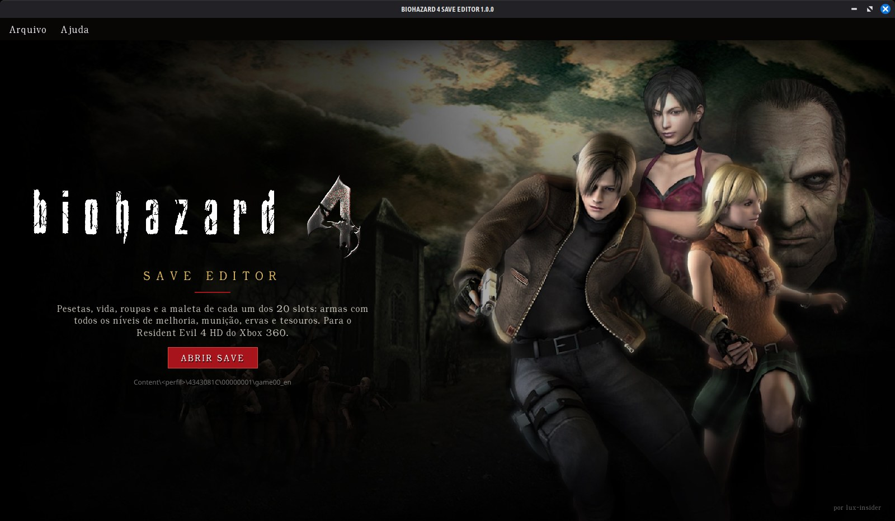
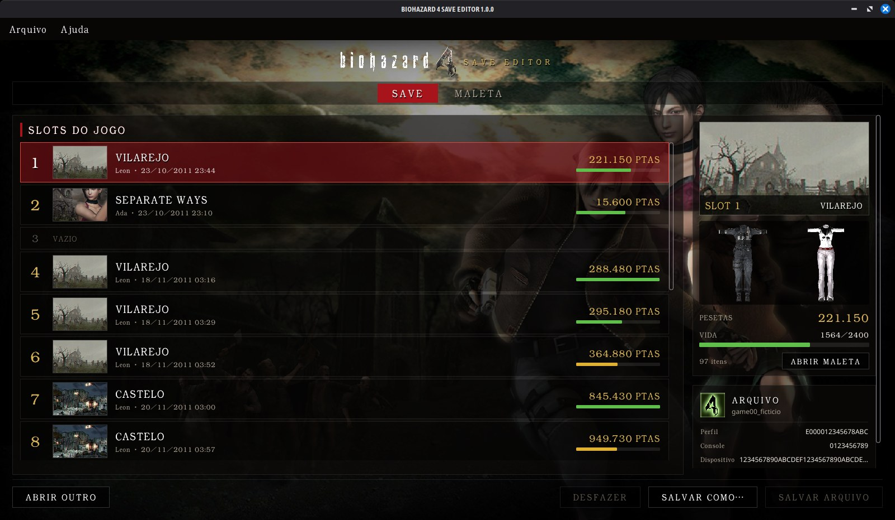
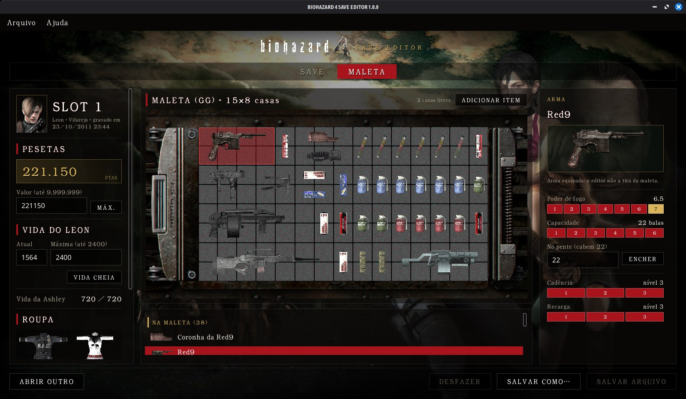
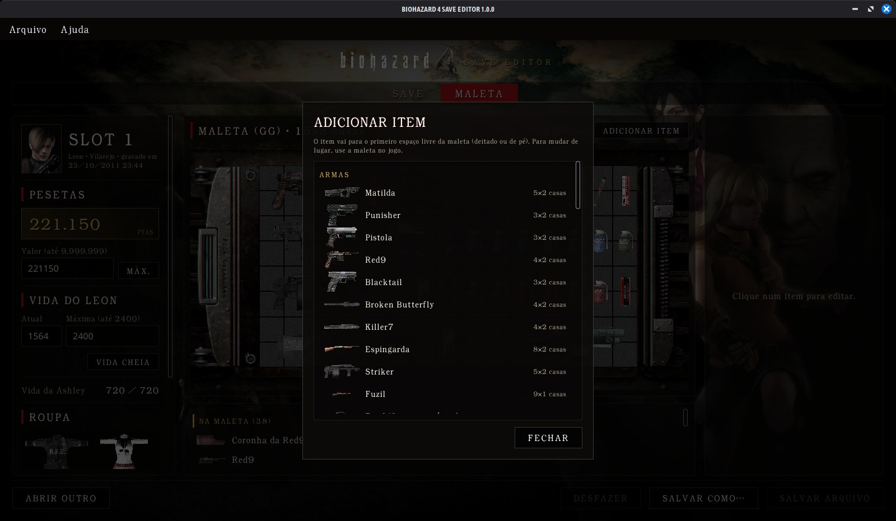

# BIOHAZARD 4 SAVE EDITOR

[](https://github.com/lux-insider/biohazard4-save-editor/releases/latest)
[](LICENSE)




Editor de save do **Resident Evil 4 HD** para **Xbox 360**, em português, com
o visual do próprio jogo: arte de fundo, logo, a maleta montada com as peças
da tela de inventário, figuras dos itens e das roupas desenhadas a partir dos
modelos 3D do jogo e a fonte do jogo embutida. Programa nativo para Windows e
Linux, escrito em Rust com interface em Slint.

---

## Sumário

- [Funcionalidades](#funcionalidades)
- [Capturas de tela](#capturas-de-tela)
- [Download](#download)
- [Como usar](#como-usar)
- [Assinatura](#assinatura)
- [Segurança e integridade](#segurança-e-integridade)
- [Validação](#validação)
- [Problemas e sugestões](#problemas-e-sugestões)
- [Licença](#licença)

---

## Funcionalidades

O save do RE4 HD guarda os **20 slots** da tela de carregar do jogo, da
campanha do Leon e do Separate Ways da Ada. O editor mostra todos e edita o
slot escolhido.

| Aba | O que oferece |
|---|---|
| **Save** | Os 20 slots com a imagem do capítulo onde foram gravados (vilarejo, castelo, ilha ou Separate Ways), data, pesetas e vida. O slot escolhido aparece em destaque, com as roupas em uso. Embaixo, o arquivo: perfil, console, dispositivo e as conferências (verificações dos slots, hashes e assinatura). |
| **Maleta** | Pesetas (até 9.999.999), vida atual e máxima do Leon ou da Ada (até 2.400), vida da Ashley e a **roupa** do slot. No meio, a maleta desenhada como no jogo, com cada item no seu lugar, e a lista de todos os itens do slot (maleta, tesouros, itens-chave e arquivos). À direita, o editor do item escolhido. |

**Itens**

- **Armas:** os níveis de melhoria (poder de fogo, capacidade, cadência e
  recarga), com os valores de cada nível tirados do executável do jogo. O
  último nível de capacidade das armas que têm a melhoria exclusiva é a
  **munição infinita**. Balas no pente, com o botão ENCHER.
- **Munição, ervas, granadas e tesouros:** quantidade, até o máximo que o
  jogo aceita em cada espaço.
- **Adicionar item:** os 268 itens do jogo, com figura e tamanho em casas. O
  item vai para o primeiro espaço livre da maleta, deitado ou de pé. Inclui as
  maletas maiores (P, M, G e GG, até 15×8 casas).
- **Tirar da maleta:** qualquer item, menos a arma equipada (essa troca é com
  o jogo).

**Roupas**

| Escolha | Leon e Ashley | Ada |
|---|---|---|
| Normal | roupa de sempre / Ashley normal | clássica (RE2) |
| Especial 1 | policial de Raccoon City (RPD) / Pop Star | espiã |
| Especial 2 | gângster / armadura | vestido vermelho |

A escolha vale para Leon e Ashley juntos, como no menu do jogo: ao carregar,
o jogo refaz a roupa a partir dela.

---

## Capturas de tela

| | |
|---|---|
|  |  |
|  |  |

As capturas usam um save com perfil, console e dispositivo fictícios.

---

## Download

Baixe a versão mais recente na página de
[**Releases**](https://github.com/lux-insider/biohazard4-save-editor/releases/latest).

| Arquivo | Sistema |
|---|---|
| `BIOHAZARD4-SAVE-EDITOR-<versão>-windows-x86_64.zip` | Windows 10 e 11 (64 bits) |
| `BIOHAZARD4-SAVE-EDITOR-<versão>-linux-x86_64.tar.gz` | Linux x86_64 |
| `SHA256SUMS.txt` | hashes para conferir os downloads |

Descompacte a pasta inteira. Não é preciso instalar nada; no Windows, o
programa não depende do Visual C++ Redistributable.

```
BIOHAZARD 4 SAVE EDITOR/
├── BIOHAZARD 4 SAVE EDITOR.exe   (Linux: biohazard4-save-editor)
├── LEIA-ME.txt                   guia rápido
├── LICENSE
├── console/                      lugar opcional do kv.bin do seu console
└── backups/                      cópia do save antes de cada gravação
```

---

## Como usar

1. **Faça backup do save.** Copie a pasta `Content` do pendrive ou do HD.
2. Abra o programa e clique em **ABRIR SAVE**. O save fica em
   `Content\<perfil>\4343081C\00000001\` e se chama `game00_` mais o
   idioma do jogo (`game00_en`, `game00_ge`...).
3. Na aba **Save**, escolha o slot. Cada slot mostra a data e a área onde
   foi gravado, então o mais recente é fácil de achar. Na aba **Maleta**,
   faça as alterações.
4. Salve e devolva o arquivo para a **mesma pasta** no pendrive ou no HD.
5. No jogo, carregue o **mesmo slot** que você editou.

O save guarda os 20 slots e o editor muda só o slot escolhido: os outros
ficam como estavam. Depois de carregar o slot, o que você colocou na maleta
vai junto quando salvar de novo no jogo, em qualquer slot.

> **Não jogue enquanto o save estiver fora do Xbox.** O arquivo devolvido
> substitui o do console inteiro: se você salvar no jogo enquanto edita, esse
> progresso se perde. Tire o save, edite e devolva antes de jogar de novo.

Para trocar um item de lugar na maleta, use a maleta dentro do jogo.

---

## Assinatura

O save sai sempre assinado e pronto para o console, com a chave interna do
programa. Quem preferir pode colocar o `kv.bin` do próprio console em
`console/kv.bin`, ao lado do programa; ele passa a ser usado no lugar da
chave interna. O `kv.bin` é a identidade do console: não compartilhe. Ele
nunca entra no repositório.

---

## Segurança e integridade

- **Gravação segura:** o arquivo é montado e conferido em memória, gravado numa
  cópia temporária, relido e só então substitui o original.
- **Backup automático** do arquivo anterior na pasta `backups/`.
- **Conferência completa:** as duas verificações (CRC32) de cada slot
  alterado, os hashes SHA-1 do pacote (dois níveis de tabela) e a assinatura.
- **Validação na abertura:** só aceita pacotes CON de save do Resident Evil 4
  HD (Title ID `4343081C`).
- **Slots preservados:** os slots que você não mexeu saem idênticos, byte a
  byte.
- **Edições restritas ao que o jogo aceita:** máximos de cada item por
  espaço, níveis de melhoria existentes em cada arma e itens só onde cabem na
  maleta, sem sobrepor outro.

---

## Validação

Saves gravados pelo código do editor foram carregados num Xbox 360 real:

- o save abre no jogo, com todos os slots intactos;
- o Canhão de Mão e a Metralhadora de Gângster com a capacidade exclusiva
  ficaram com **munição infinita**;
- a maleta GG adicionada passou a valer no jogo (15×8 casas), com a arma e a
  munição novas no lugar;
- a escolha de roupa (Especial 2) carregou Leon de gângster e Ashley de
  armadura.

O formato foi conferido nos saves de exemplo: todos os CRCs batem, os 319
itens de maleta cabem sem se sobrepor e abrir e salvar sem alterações devolve
os slots idênticos.

---

## Problemas e sugestões

Erros e ideias são bem-vindos nas [issues](https://github.com/lux-insider/biohazard4-save-editor/issues/new/choose),
com um modelo para cada caso. Para falhas de segurança, veja o
[SECURITY.md](SECURITY.md).

---

## Licença

Programa **gratuito (freeware)**, de código fechado: pode usar à vontade, mas
não pode vender, republicar em outros sites nem modificar. Os termos completos
estão no [LICENSE](LICENSE).

A interface usa o [Slint](https://slint.dev) sob a Slint Royalty-free License,
que pede o selo abaixo na página de download do programa. A fonte Noto Sans
está sob a SIL Open Font License (o `OFL.txt` vai junto no download).

*Resident Evil 4* / *BIOHAZARD 4* © CAPCOM CO., LTD. As imagens, os modelos,
os textos e a fonte do jogo (`BIO4.ttf`, convertida da original) pertencem à
Capcom. Projeto de fã, gratuito e sem fins lucrativos, sem ligação com a
Capcom ou a Microsoft.

[](https://slint.dev)
